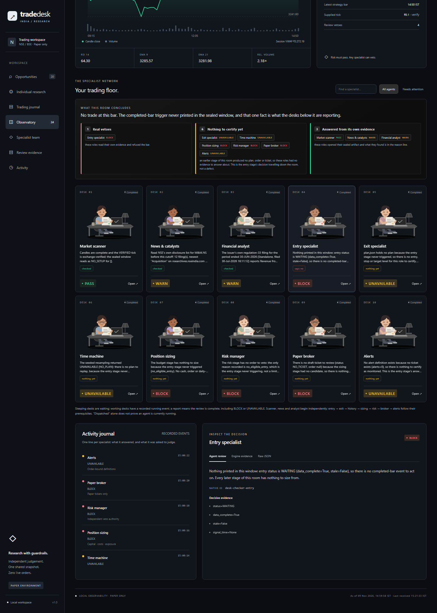
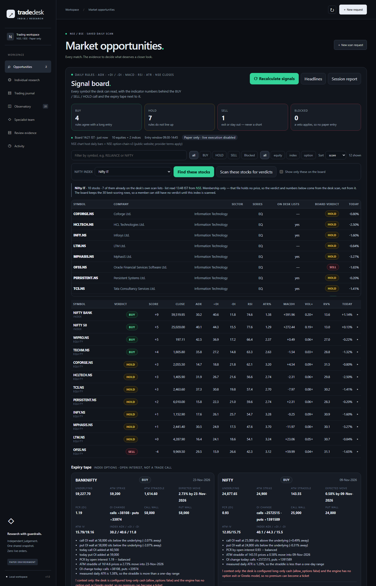
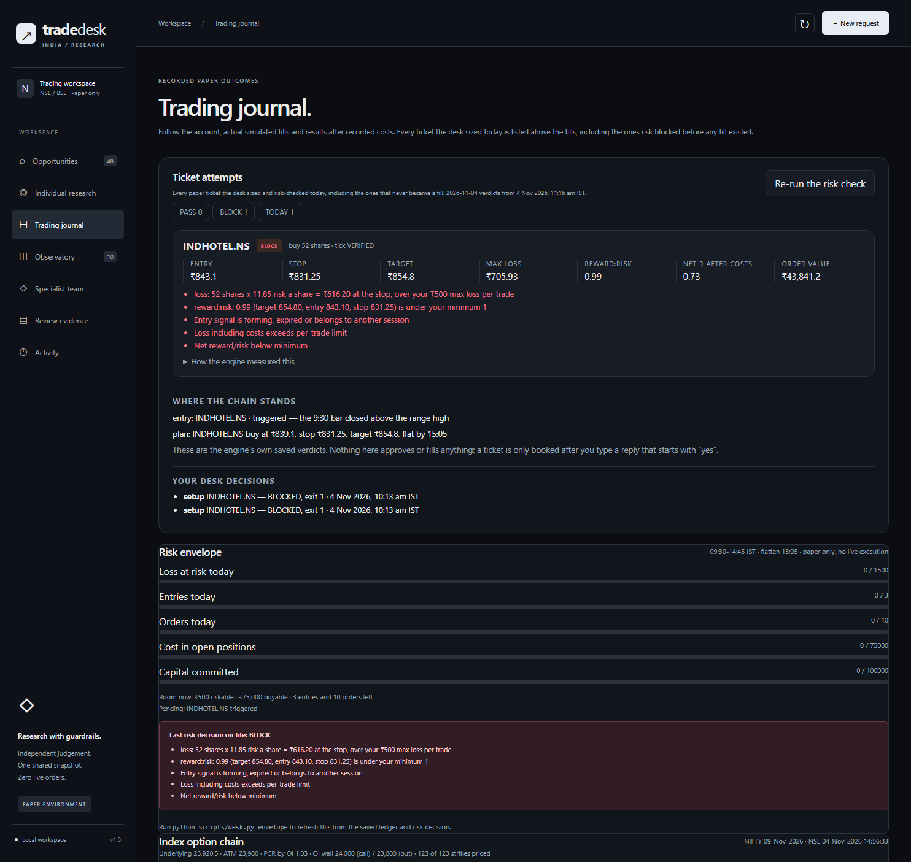
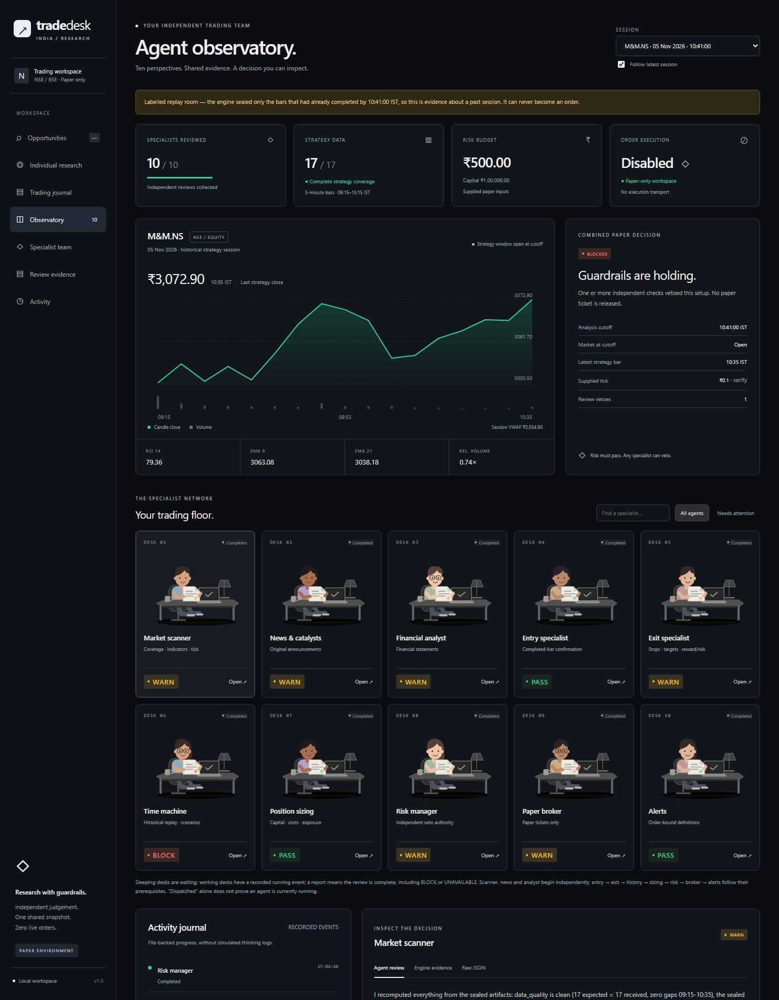

# Indian day-trading desk (paper only)

A personal NSE/BSE day-trading desk built on
[`day-trader-skill-codex`](https://github.com/jackson-kanchanapally/day-trader-skill-codex)
(vendored in `vendor/`), wrapped in one Windows-safe command:
`python scripts/desk.py`.

It scans for setups, checks the entry on completed bars, plans a tick-rounded
stop and target, sizes the trade against INR cash and Indian intraday costs, runs
a risk check, and prints a **paper ticket**. On top of that it scores the whole
universe into **BUY / HOLD / SELL** with the indicator values behind each verdict,
writes a dated session report, and can seal one symbol into a **room of ten
independent specialist reviews** you can inspect line by line. All of it is
reachable from the local dashboard, including the commands the buttons run.
Nothing here sends an order. The engine keeps `execution_enabled: false`, and
this desk never types a consent reply on your behalf.

## What it is not

* No broker connection, no live orders, no futures, no margin, no shorting, no
  fractional shares. The option **chain** is read for context (premiums, IV, open
  interest) and the lot size and tick for any listed strike are known from the
  cached instrument directory -- but no option leg is sized, risk-checked or
  ticketed: `allow_options` is false and the engine's exit and risk model is
  whole-share cash-segment equity.
* Not investment advice. The numbers are a simulated account.
* Market data comes from NSE's public charting endpoint plus the public
  option-chain endpoint on the website, both of which the engine labels
  *experimental* -- availability and freshness are not guaranteed.

## Requirements

| | |
|---|---|
| Python | 3.9+ (this desk runs on 3.14.6, standard library only) |
| OS | Windows 10/11 works; `india/job.py` needs `fcntl`, so scheduling is foreground polling instead |
| Node | 20.19+ / 22.12+ only for the dashboard build |
| Data | NSE public feed, no key: `charting.nseindia.com` for candles, `www.nseindia.com` for the option chain. Optional: `UPSTOX_ANALYTICS_TOKEN` in your environment |
| Console | UTF-8; the desk reconfigures stdout and sets `PYTHONIOENCODING` for children so `₹` prints |

## Setup

```sh
cd desk
python scripts/desk.py doctor          # environment, config, tick registry, feed, ledger
python scripts/install_skills.py       # link the 12 trader-* skills into ~/.qoder/skills
```

`install_skills.py` uses directory junctions on Windows (no symlink privilege or
Developer Mode needed) and is idempotent. Each linked skill still resolves back to
`vendor/day-trader-skill-codex`, so `run.py` imports the engine correctly, and
`~/.qoder/skills/docs` makes the `../docs/WORKFLOW.md` links inside every
`SKILL.md` readable. Restart Qoder to pick the skills up; they then appear as
`trader-scanner`, `trader-entry`, `trader-exit`, `trader-budget`, `trader-risk`,
`trader-broker`, `trader-timemachine`, `trader-alerts`, `trader-news`,
`trader-analyst`, `trader-pelosi`, `trader-team`.

## Your first look at the market

```sh
python scripts/desk.py premarket            # daily setups across config/universe-liquid.txt
python scripts/desk.py scan orb --limit 25  # 15-minute opening ranges
python scripts/desk.py status               # clock, cash, alerts, today's risk
```

Real output from 2026-11-03, 10:35 IST, NSE feed, 25 symbols requested:

```text
== daily scan | 98 symbols | limit 25 ==
as of 2026-11-03T10:35:52+05:30 | source NSE experimental website adapter; provider terms apply
scanned 25 of 25 | failures 0
RELIANCE.NS          1300.0 breakout_20d,reclaim_ma20        rsi 65.8   volx 6.3    high20 1218.0     ma20 1193.03
SBIN.NS               987.0 breakout_20d                     rsi 56.0   volx 1.09   high20 973.7      ma20 959.7
BANKBARODA.NS        245.16 breakout_20d                     rsi 61.2   volx 2.01   high20 241.31     ma20 234.84
HCLTECH.NS           1434.0 breakout_20d,bull_flag           rsi 70.7   volx 0.79   high20 1428.1     ma20 1337.62
PERSISTENT.NS        6051.0 breakout_20d                     rsi 65.5   volx 1.74   high20 6048.0     ma20 5778.8

A daily match is a lead, not an eligible entry. Candle dates: 2026-11-02
```

## From a lead to a paper ticket

Both halves of a live entry are buttons on the row in **Opportunities**, so the
clock is never something you have to beat by hand:

* **Run the paper chain on `<SYMBOL>`** -- entry, exit plan, sizing, risk,
  ticket in one pass, judged on the bar that has already closed.
* **Watch the next bar and run the chain on `<SYMBOL>`** -- polls every 20
  seconds for five minutes and runs that same chain on the bar that breaks.

The second one exists because of a hard rule in the engine, not a preference:
the risk stage only passes a signal whose bar closed within one bar step, so on
a 5-minute chart the window is the five minutes after the trigger bar -- and the
NSE feed was about three minutes behind when measured today. A "scan, read, then
type" pass usually lands too late, which is exactly what the refusal panels
below show.

Under the watch button the desk prints one readable line per check. This is the
whole of a real pass started from the drawer at 11:12 IST on 2026-11-06; it
polled fifteen times, five of those checks are shown, nothing else is touched:

```text
== watching LT.NS for a completed-bar orb entry | every 20s, stops after 15 checks or the first trigger ==
tick INR 0.10 | a trigger writes C:\...\desk\workspace\entry.json and runs the chain in this same pass
  11:12:53 waiting   last close ₹4031.60 (11:05 bar), ₹17.40 under the range high ₹4049.00 (-0.43%)
  11:13:13 waiting   last close ₹4031.60 (11:05 bar), ₹17.40 under the range high ₹4049.00 (-0.43%)
  11:15:16 waiting   last close ₹4033.60 (11:10 bar), ₹15.40 under the range high ₹4049.00 (-0.38%)
  11:16:18 waiting   last close ₹4032.60 (11:10 bar), ₹16.40 under the range high ₹4049.00 (-0.41%)
  11:17:41 waiting   last close ₹4032.60 (11:10 bar), ₹16.40 under the range high ₹4049.00 (-0.41%)

No trigger inside the poll window; entry.json still holds waiting.
```

290.3 seconds of live NSE, no break, so nothing was sized, risked or booked.
That is a normal and correct answer, not an empty panel.

The same engine command, if you ever want it in a terminal, is
`python scripts/desk.py watch AXISBANK.NS --every 15 --max-checks 60 --stop
or-mid --target 2R`.

A third panel appears only when it is earned. **Risk budget for this run** shows
up under a chain the engine refused for costs: sizing divides your limit by the
risk *per share* and ignores costs, while the risk stage adds them back, so 36
shares of RELIANCE can sit at ₹536.22 of real exposure while the ₹500 cap looks
respected. Typing 450 into that box and pressing **Re-run the paper chain with
this budget** is the whole fix -- and the field refuses anything above the cap,
so it can only ever shrink a position:

```text
  [BLOCK] RELIANCE.NS buy 36 shares | stop 1301.0 | max loss INR 536.22 | net R:R 1.19 | tick VERIFIED
      reason: Entry signal is forming, expired or belongs to another session
      reason: Loss including costs exceeds per-trade limit

  [BLOCK] RELIANCE.NS buy 33 shares | stop 1301.0 | max loss INR 448.59 | net R:R 1.40 | tick VERIFIED
      reason: Entry signal is forming, expired or belongs to another session
```

Same order, same morning, 09:55 then 10:10 IST. The costs reason is gone and net
reward:risk rose from 1.19 to 1.40; what remains is the signal-timing reason,
which no budget can clear.

That timing refusal gets its own honest panel, and it deliberately has no
button. Captured at 11:10 IST on JSWSTEEL.NS, whose first breakout bar was the
10:15 one:

```text
== risk check ==
2026-11-06 2026-11-06 11:10 IST | pass 0 | block 1 | cash after INR 100,000.00
  [BLOCK] JSWSTEEL.NS buy 36 shares | stop 1336.6 | max loss INR 492.02 | net R:R 1.39 | tick VERIFIED
      reason: Entry signal is forming, expired or belongs to another session

== paper ticket ==
BLOCKED | BUY JSWSTEEL.NS 36 shares | max loss INR 492.02
      reason: This exact order has no risk PASS
      reason: Entry signal is forming, expired or belongs to another session
```

Above that block the same pass printed the levels, which are real: `status
triggered | eligible False | price 1347.5 at 10:20`, `the 10:15 bar closed above
the range high`, stop 1336.60, target 1369.30.

The desk calls this refusal **The break already happened, and the window closed
with it**, and the panel deliberately carries no button. No re-run changes it: on
a symbol that has already broken, a watch pass returns on its very first check
and inherits the same old bar, so pressing watch would only re-block. The panel
says so and points at a row that is still `waiting`.

That is where the other panel belongs. At 11:05 IST LT.NS was ₹17.40 under its
range high, so the chain had nothing to size:

```text
== entry check | LT.NS | tick INR 0.10 ==
status waiting | eligible False | price None at None
opening range 3996.1 - 4049.0 (15 min, 2026-11-06)
reason: last close ₹4031.60 (11:05 bar), ₹17.40 under the range high ₹4049.00 (-0.43%)

No triggered entry, so nothing was planned, sized, risk-checked or ticketed.
```

**No completed bar has broken the range yet** is what the drawer calls that, and
it puts the watch button right underneath -- the row is still live, so catching
the next bar is the correct move. Pressed there, the pass is the 11:12 one at the
top of this section.

A fresh ticket looked like this (real run, while the signal was still current):

```text
== paper ticket ==
READY_PAPER_TICKET | buy AXISBANK.NS 37 shares | max loss at stop (cost inclusive) INR 496.79
fingerprint 970ca7a3111990ad645ac61cf36d182b09862eade5dc3d3b43e6190a11b5a6c7
execution_enabled False
```

Later, on 2026-11-03, a 10:45-bar breakout re-checked at 11:10 saw the same chain
refuse itself for seven honest reasons -- a ticket is only good for the moment it
was computed:

```text
== paper ticket ==
BLOCKED | buy ICICIBANK.NS 42 shares | max loss INR 638.60 | tick VERIFIED
fingerprint a33223ae553e9bb2f33d34656939c89c4eec4d7c2ade308466a54d312abd9a34
      reason: Configuration or paper portfolio changed; rerun risk
      reason: This exact order has no risk PASS
      reason: loss: 42 shares x 12.30 risk a share = ₹516.60 at the stop, over your ₹500 max loss per trade
      reason: reward:risk: 0.85 (target 1425.50, entry 1415.00, stop 1402.70) is under your minimum 1
      reason: Entry signal is forming, expired or belongs to another session
      reason: Loss including costs exceeds per-trade limit
      reason: Net reward/risk below minimum
```

That is the point: a ticket is only good for the moment it was computed.

## Recording a decision (you, not the desk)

The dashboard's **Your own reply, typed by you** box is the normal path -- it is
the same engine call, and the desk never fills it for you. The CLI is here only
because it is the same contract spelled out:

```sh
python scripts/desk.py ticket
python scripts/desk.py approve --reply "yes, take the 37-share AXISBANK buy at 1231"
```

`approve` must run within 60 seconds of the ticket being shown, the reply must be
your own unambiguous yes, and if the reply names a different instrument the engine
rejects it. The recorded event is a **local simulated fill**, never a broker
acknowledgement. `desk.py approve --reply "let me think"` fails closed and leaves
the ledger untouched -- verified: `0 ledger events`.

## Index board

```sh
python scripts/desk.py index
```

Equity setups do not happen in a vacuum, so the desk reads the benchmark context
from the same NSE chart host the candles come from. Real output, 2026-11-03 12:35 IST:

```text
NIFTY 50              23,671.40  chg +0.98%  day 23,482.80-23,705.20  orb 23,482.80-23,628.30  above
NIFTY BANK            55,528.85  chg +0.96%  day 55,174.10-55,599.50  orb 55,174.10-55,486.95  above
NIFTY FIN SERVICE     25,290.15  chg +1.57%  day 25,048.15-25,314.45  orb 25,048.15-25,203.35  above
NIFTY IT              32,343.95  chg -0.30%  day 32,306.05-32,879.35  orb 32,529.30-32,857.85  below

futures  NIFTY26NOVFUT         23,717.30 | premium 45.9 pts (0.194%) as of 2026-11-03T12:30:00+05:30
```

`above`/`below`/`inside` is the state of the last completed 5-minute bar against the
09:15-09:30 opening range, and `breadth` (when a daily scan is saved) counts how many
of the 98 listed names sit above MA20 or a 20-day high.

**No option candles on this host.** The chart endpoint resolves strikes and expiries
(`NIFTY26D0125750CE`, scripcode 47837) but returns **zero candles** for option scrips,
so premiums are not on `charting.nseindia.com`. They are on the website's chain API --
see the next section.

## Option chain

```sh
python scripts/desk.py options              # NIFTY, nearest expiry
python scripts/desk.py options BANKNIFTY --strikes 11
python scripts/desk.py options RELIANCE --expiry 23-Nov-2026
```

Premiums, IV and open interest come from `www.nseindia.com/api/option-chain-v3`. The
one thing that makes this work is the **cookie handshake**: visit `/option-chain` first
and keep the `nsit` / `bm_sz` cookies, then call the API from the same session with a
browser `Referer`. Without it NSE answers 403/404, which is exactly what an earlier
probe of this desk concluded -- the data was never missing, the handshake was. Real
output, 2026-11-03 13:47 IST:

```text
NIFTY 03-Nov-2026 | underlying   23,730.65 | NSE timestamp 03-Nov-2026 13:47:28
  strikes 114 (priced 114) | PCR by OI 1.93 | by today's OI change 2.35
  OI resistance     23,800 | OI support     23,700 | today's buildup  1,388,939 call /  3,258,931 put

      strike |   CE ltp   CE iv      CE oi     CE dOI |   PE ltp   PE iv      PE oi     PE dOI
      23,550 |   178.70     0.0     50,839    -26,883 |     4.15    10.1    297,006    294,744
      23,600 |   132.50     0.0    120,383    -39,747 |     7.55     9.3    622,042    617,993
      23,650 |    89.30     6.6    144,153     77,229 |    14.70     8.8    501,942    500,872
      23,700 |    53.45     7.1    325,827    210,006 |    28.95     8.5    635,929    634,700
      23,750 |    28.05     7.3    356,182    306,409 |    53.35     8.6    237,717    237,424  <= ATM
      23,800 |    12.70     7.4    442,486    334,208 |    88.60     9.1    148,734    147,938
      23,850 |     5.30     7.7    327,058    299,645 |   130.65    10.0     30,873     30,735
```

`0.0` IV means NSE published none for that strike; the desk keeps it as zero instead of
back-solving a number. `PCR by OI` is put OI over call OI, `OI resistance/support` are
the heaviest call and put strike walls, and `today's buildup` is the change in OI, which
is the more useful of the two intraday. A negative-side ratio is refused rather than
printed: if either leg is unwinding, `by today's OI change` shows `n/a (one side unwound)`
because the sign of such a ratio is meaningless.

Still a hard boundary: this is **context**, not a trade. No lot size, no notional, no
margin, no option ticket -- the engine cannot risk an option leg and this desk will not
pretend it can.

## Risk envelope

```sh
python scripts/desk.py envelope
```

The engine's answer to "can I take this trade" is a per-order PASS/BLOCK, which
does not tell you how much of the day's budget is already gone. `envelope` reads
the saved config, ledger and `state/risk.json` and shows the limits as usage
bars. Real output, 2026-11-03 13:10 IST:

```text
== risk envelope ==
as of 2026-11-03T13:10:50.279883+05:30 | paper True | no live execution
entry window 09:30-14:45 IST | flatten 15:05
  loss_at_risk     0.0% |.........................| used 0.0 / 1500.0
  trades           0.0% |.........................| used 0 / 3
  orders           0.0% |.........................| used 0 / 10
  position_cost    0.0% |.........................| used 0 / 75000.0
  cash             0.0% |.........................| used 0.0 / 100000.0
  room now: risk 500.0 | buy 75000.0 | trades left 3 | orders left 10
  last risk decision on file: BLOCK
    blocked: loss: 47 shares x 15.00 risk a share = ₹705 at the stop, over your ₹500 max loss per trade
    blocked: reward:risk: 0.52 (target 1425.50, entry 1417.70, stop 1402.70) is under your minimum 1
    blocked: Entry signal is forming, expired or belongs to another session
    blocked: Loss including costs exceeds per-trade limit
    blocked: Net reward/risk below minimum
  pending signal: ICICIBANK.NS (triggered, eligible False)
```

`room now: risk 500.0` is the smaller of ₹500 per trade and whatever is left of
the ₹1,500 daily loss budget -- not ₹500 plus the daily remainder. Nothing here
re-risks anything: the command never calls the risk role, because a fresh
`state/risk.json` would overwrite the decision the consent chain is keyed to.

## Signal board -- BUY / HOLD / SELL, with the numbers behind them

```sh
python scripts/desk.py signals                 # 30 names + indices + the expiry tape
python scripts/desk.py signals --all           # the whole saved universe (several minutes)
python scripts/desk.py signals --symbols RELIANCE.NS,TCS.NS --days 120
```

The scan answers "is there a setup"; this answers "which way do the rules lean,
and how could you check that yourself". It recomputes ADX, +DI, -DI, RSI(14),
ATR, MACD(12/26/9), EMA20/50, a 20-day high, volume against the 20-session mean
and realized volatility from the same daily bars the scanner uses, then scores
them into one verdict per name. ADX is compared with its own previous value, so a
name says whether the trend is strengthening or maturing, and volume is always
read off the last **completed** session -- never the bar still forming. Real
output, 2026-11-04 13:09 IST:

```text
== signals | 98 equities (top 30), 100 daily bars, 2 saved chain(s) ==
as of 2026-11-04T13:09:26+05:30 | NSE chart host daily bars + NSE option-chain-v3

indices (2)
  symbol                  close    ADX    DI+    DI-    RSI   ATR%     MACDh   volx    rv% verdict
  NIFTY 50              23843.2   29.1   33.2   17.8  67.16   1.24  161.0809   1.19  12.05 BUY (6)
  NIFTY BANK            55673.4   21.2   21.2   18.7  55.24   1.25  145.9139   1.12  11.55 HOLD (1)

equities (30, universe 30)
  symbol                  close    ADX    DI+    DI-    RSI   ATR%     MACDh   volx    rv% verdict
  RELIANCE.NS            1307.9   27.4   35.4   16.8  66.79   2.51    16.799   2.27  29.91 BUY (7)
  INDHOTEL.NS            842.25   35.1   31.8    7.2  75.75   2.36    7.0828   0.86  23.16 BUY (7)
  JINDALSTEL.NS          1124.3   29.4   24.9   17.3  62.92   2.54   12.5156   1.85  26.11 BUY (7)

verdicts: BUY 15 HOLD 16 SELL 1 | 32 of 32 clear of vetoes

options tape  NIFTY 09-Nov-2026 | underlying 23794.15 | ATM 23800.0 straddle 368.1 (expected move 1.55%)
              PCR 0.95 | walls 24000.0 call / 23600.0 put | bias BUY (6) | iv c/p 14.43/18.88
              veto: context only: the desk is configured long-only cash (allow_options false) and
                    the engine has no option exit or Greeks model, so no premium can become a ticket

vix        not published -- India VIX resolves on the chart host (scripcode 26011) but its series
           reads ~100x the published index value, and no keyless cross-check endpoint answered.
```

`BUY` means the rules agree with a long cash entry, `SELL` means get out or stay
out -- this desk never shorts -- and `HOLD` means the rules do not line up. The
options tape scores the index the same way and adds the OI walls, PCR and the
move the ATM straddle is actually pricing, then refuses to go further: the lot
size and tick are on file from the instrument directory, but `allow_options` is
false and there is no option exit model, so no premium becomes a ticket. India
VIX is not printed at all until the unit scale is verified against a second
source -- realized volatility and the straddle's expected move are shown
instead.

The board's universe is not fixed to the config lists. `desk.py universe "NIFTY
MIDCAP 150"` prints the constituents from NSE's own file, and
`desk.py scan daily --index "NIFTY IT"` scores exactly those names, so
`signals` afterwards describes the index instead of the saved list. On the
dashboard both are buttons under the board filters; see
*The Signal board can now name the stocks inside a Nifty index* below.

## Search any symbol -- the live detail read

```sh
python scripts/desk.py detail RELIANCE
python scripts/desk.py detail "NIFTY 50"
python scripts/desk.py detail "NIFTY 24000 CE"
python scripts/desk.py detail "BANKNIFTY 03-Dec-2026 55800 PE"
python scripts/desk.py filings RELIANCE
python scripts/desk.py report --symbol RELIANCE
```

`detail` is the one command that makes live calls on demand: daily candles, today's
5-minute tape, the option chain and the issuer's own exchange filings for whatever
you name. Names resolve through
the cached instrument directory (78,291 rows, no API key) rather than a scraper,
so it answers for any NSE cash scrip and for any listed call or put strike. It
prints the contract geometry the rest of the desk had to leave blank -- lot,
tick, premium and notional for one lot -- sizes an ATR stop against the cash and
the ₹500 risk cap, and lists the dated corporate announcements NSE holds for that
company with a link to each filing PDF. Results are cached for 15 minutes;
`--refresh` ignores the cache. Real output, 2026-11-05 11:03 IST:

```text
== detail | RELIANCE ==
detail RELIANCE -> equity (2026-11-05T11:03:22.091552+05:30)
  symbol:  RELIANCE | RELIANCE INDUSTRIES LTD | tick Rs 0.1 | lot 1 | workspace tick registry (config/security-master.csv)

DAILY  RELIANCE.NS | 69 bars | bar as of 2026-11-05T09:15 (today's bar still forming)
  RELIANCE.NS BUY (score 4)
  close    1,307.50  chg  -0.27%  ADX  28.2  +DI  35.7  -DI  15.8  RSI  66.2  ATR   32.36 (2.47%)
  EMA20    1,229.84  EMA50    1,244.34  20d high    1,318.90  20d low    1,152.20  MACDh    17.79  vol x  1.20  rv  29.9%
  window 2026-07-29..2026-11-05: high    1,337.00 (2026-08-07) -2.21% away | low    1,152.20 (2026-10-13) 13.48% away | avg vol   28,527,809
    - trend: EMAs crossed over, no clean structure (0)
    - ADX 28.2 with +DI 35.7 over -DI 15.8: trending up (+2)
    - MACD histogram 17.7927 and widening (+1)
    - RSI 66.25 shows demand (above 60) (+1)

INTRADAY 5m  RELIANCE.NS | 22 bars today | last 1307.5 at 2026-11-05T11:00
  open  1,323.00  high  1,325.00  low  1,303.70  range   1.63%  prev close  1,311.00  gap   0.92%
  15m opening range 1325.0-1315.4 (mid 1320.2, width 0.73%) -- price is below, 17.5 up / 0.0 down to break

CHAIN  RELIANCE 23-Nov-2026 | NSE type Equity | underlying 1308.4 | ATM 1310.0
  PCR by OI 0.78 | OI 224779 calls / 175266 puts | today 7672 call / -5069 put | walls 1300.0/1100.0
      strike    CE ltp   CE iv      CE oi |    PE ltp   PE iv      PE oi
       1,230     85.65   21.01       5408 |      4.05   24.44       6407
       1,240      76.8   19.96       4914 |      4.85   23.53       6378
       1,250      67.5   23.39      15527 |      5.85   22.71      14934
       1,260      58.7   22.65       4770 |       7.4   21.96       6637
       1,270      50.7   21.11       5752 |      9.05   21.36       3418
       1,280      43.1   21.74       9551 |     11.55   20.95       4398
       1,290     36.35   21.14      11890 |     14.65   20.71       4017
       1,300      30.2   21.12      29322 |     18.55   20.52      12815
       1,310     24.85   20.94       6216 |      22.8   20.37       3024  <= ATM

FILINGS  RELIANCE | NSE corporate announcements (www.nseindia.com, exchange disclosure archive)
  27 disclosures in the last 45 days (fetched 2026-11-05T11:03:32.856298+05:30)
  04-Nov-2026 20:47 IST Credit Rating                  https://nsearchives.nseindia.com/corporate/PVIVINMA_04112026204646_SE_RIL_041126.pdf
                        Reliance Industries Limited has informed the Exchange about Credit Rating
  01-Nov-2026 23:09 IST Analysts/Institutional Investo https://nsearchives.nseindia.com/corporate/kavinavora_01112026230907_SE_01112026.pdf
                        Transcript of the discussion on the Unaudited Financial Results (Consolidated and Standalone) of the Company f
  31-Oct-2026 17:34 IST Analysts/Institutional Investo https://nsearchives.nseindia.com/corporate/kavinavora_31102026173331_SE_31102026_AR.pdf
                        Audio recording of the discussion on the Unaudited Financial Results (Consolidated and Standalone) of the Comp
  30-Oct-2026 19:47 IST Investor Presentation          https://nsearchives.nseindia.com/corporate/kavinavora_30102026194557_SE_30102026_IP.pdf
                        Reliance Industries Limited has informed the Exchange about Investor Presentation
  30-Oct-2026 19:43 IST Press Release                  https://nsearchives.nseindia.com/corporate/kavinavora_30102026194315_SE_30102026_MR.pdf
                        In continuation of our letter of today's date on the Unaudited Financial Results (Consolidated and Standalone)
  30-Oct-2026 19:40 IST Outcome of Board Meeting       https://nsearchives.nseindia.com/corporate/kavinavora_30102026193935_SE_30102026_Results.pdf
                        In continuation of our letter dated October 27, 2026, we wish to inform you that the Board of Directors of the
  30-Oct-2026 19:40 IST Outcome of Board Meeting       https://nsearchives.nseindia.com/corporate/kavinavora_30102026193952_SE_30102026_Results.pdf
                        In continuation of our letter dated October 27, 2026, we wish to inform you that the Board of Directors of the
  29-Oct-2026 08:55 IST Other Restructuring            https://nsearchives.nseindia.com/corporate/kavinavora_29102026084603_SE_29102026.pdf
                        Disclosure under Regulation 30 of the Securities and Exchange Board of India (Listing Obligations and Disclosu

SIZING  ATR(14) = 32.36 | 15 shares fits a Rs 500 cap and Rs 100000.0 cash | position Rs 19612.5
  Indicative only -- the engine budget and risk stages decide the real ticket.

Detail is a read of the tape, not an order. A signal becomes a paper ticket only through the engine: entry, exit, budget, risk, then your own consent reply.

Option geometry (lot, tick, premium for one lot, notional) comes from the cached instrument directory and is context: the desk is configured long-only cash and the engine has no option exit model, so no premium here is sized or ticketed.
```

A name NSE no longer carries is refused feed by feed, with the reason, and the
command answers with the scrips that *are* on file instead of a blank screen.
Real output, 2026-11-05 10:49 IST (`TATAMOTORS` went into the demerged `TMCV`
and `TMPV`, and the chart host returns zero rows for the old symbol):

```text
== detail | TATAMOTORS ==
detail TATAMOTORS -> equity (2026-11-05T10:49:00.909306+05:30)
  symbol:  TATAMOTORS | equity | tick Rs n/a | lot n/a | -
  unavailable daily:    ValueError: NSE could not uniquely resolve equity TATAMOTORS.NS
  unavailable intraday: ValueError: NSE could not uniquely resolve equity TATAMOTORS.NS
  unavailable chain:    NSE lists no option chain for TATAMOTORS (Indices: NSE listed no expiries for TATAMOTORS | Equity: NSE listed no expiries for TATAMOTORS)
  unavailable suggest:  NSE lists no cash-equity scrip named TATAMOTORS -- it is either delisted or renamed. Closest names on file: TMCV, TMPV.

nothing came back for TATAMOTORS -- every source above refused.
```

`filings RELIANCE` reads the same exchange-disclosure archive on its own. This is
the desk's only primary source: the announcement text and the PDF hosted on
`nsearchives.nseindia.com`, dated, no aggregator in between. Headlines from the
news feed remain leads, never evidence -- the specialist `news` role is charged to
PASS or WARN only against an nseindia.com / bseindia.com / issuer page it actually
opened, and until this command existed that bar was unreachable keyless, so the
role could only answer UNAVAILABLE. This command lists no numbers itself -- the
filing is the evidence; `financials` is what reads the instance behind it.

`report --symbol RELIANCE` writes the same read-up as prose and numbers into
`reports/symbol-RELIANCE-<date>.md` and `.html`, assembled from the cached
detail document, so it cannot disagree with what you just looked at.

In the dashboard this is the search box in Research: type a company name, an
index, or `NIFTY 24000 CE` and the answer card carries the daily verdict with
all fifteen indicators, the 5-minute tape with the opening range, the chain with
the OI walls and the PCR, and the sizing line. Two buttons sit on that card --
**⇊ Fetch live detail** re-reads NSE, **¶ Report this symbol** writes and prints
the report -- and the near-name suggestions are clickable.

## The written report

```sh
python scripts/desk.py report
```

One dated file per session, markdown and HTML in `reports/`, assembled only from
what is already saved: envelope, signal board, the option tape, the sealed team
room, headlines and the ledger. Nothing re-fetches, so the report cannot disagree
with the dashboard. Real output, 2026-11-04 13:32 IST:

```text
== desk report | 2026-11-04 ==
# Trading desk report -- 2026-11-04

_Generated 2026-11-04 13:32 IST. Paper environment: nothing in this file was sent to a broker._

## Risk envelope
- Room per new trade: **Rs 500.0** | buy room Rs 75000.0 | trades left 3 | orders left 10
- Loss at risk today: Rs 0.0 of Rs 1500.0 | open positions 0 | cash Rs 100000.0
- Blocked: loss: 52 shares x 11.85 risk a share = ₹616.20 at the stop, over your ₹500 max loss per trade
## Signal board (2026-11-04 13:09 IST)
Verdicts: **BUY 15 / HOLD 16 / SELL 1** | 32 of 32 clear of vetoes.
```

## Ten specialists, one sealed room

```sh
python scripts/desk.py team INDHOTEL.NS
python scripts/desk.py team-dispatch indhotel-20261104-112902 risk --agent-id risk-review
python scripts/desk.py team-record indhotel-20261104-112902 risk --agent-id risk-review --review draft.json
python scripts/desk.py team-report indhotel-20261104-112902
```

`team` seals one symbol into `workspace/team/<session>/`: candles, the setup
verdict, the entry, the exit plan, the sizing, the risk result, the draft ticket
and the alerts, each written once and hash-bound to a `snapshot_id`. The ten
roles are then reviewed by ten *independent* reviewers -- in practice ten agent
runs, each reading only its own sealed artifact and writing its own verdict,
summary and evidence. `record` refuses a review whose `agent_id` was never
dispatched, and `finalize` (inside `team-report`) re-derives the budget and risk
numbers itself, so a reviewer cannot talk its way into a ticket.

This ran for real on 2026-11-04. Ten reviewer runs were dispatched, each read
its own artifact, and the room closed:

```text
== indhotel-20261104-112902 ==
INDHOTEL.NS | as of 2026-11-04T11:29:04 | BLOCKED
reviews: 10/10 recorded, 10 distinct agent ids
  scanner     WARN        Internally consistent: data_quality 26/26 5-min bars exactly matches the 09:15-to-11:20 window
  news        UNAVAILABLE Sealed news artifact carries no headline evidence (items=[], sources=[], own verdict UNAVAILABLE
  analyst     UNAVAILABLE Sealed artifact makes zero numeric claims (items=0, sources=0, filings adapter=false)
  entry       WARN        No trigger event exists, so nothing rests on a forming or stale candle: signal_time null
  exit        UNAVAILABLE No auditable geometry exists: plan.json is UNAVAILABLE with data.plan=null

  timemachine WARN        Prior-session replay is honest and clears the floor (sample_sessions 21 vs minimum 20)
  budget      WARN        orders.json exists and genuinely carries no order (order/sizing null, reason no_eligible_entry)
  risk        BLOCK       No order exists to validate: risk/orders/plan/broker all show order=null
  broker      PASS        No ticket exists (status NO_TICKET, order and order_fingerprint null), paper-only intact
  alerts      UNAVAILABLE alerts.json is itself UNAVAILABLE with data.alerts empty
  unavailable:     news, exit, alerts, analyst
  engine vetoes:   entry, budget, risk, broker
  reviewer vetoes: risk

paper ticket: none -- status is BLOCKED
live orders submitted: 0 | execution_enabled: False
```

Four of those ten answered `UNAVAILABLE` because they could not verify what they
were asked to verify -- the news and analyst runs tried NSE, BSE and the issuer's
investor-relations pages, were refused, and reported the refusals instead of
inventing citations. That is the behaviour the design wants: an unavailable
review keeps the room open, a fabricated one would have corrupted it. Two caveats
stated plainly: agent identities are host-recorded provenance, not signed
attestation; and sealing a room writes evidence only -- it starts no agent and
clears no trade.

The same room ran again on 2026-11-05, after `filings` gave the news role a route
to a primary source. Real roll-up:

```text
== m&m-20261105-105626 ==
M&M.NS | as of 2026-11-05T10:56:29 | BLOCKED
reviews: 10/10 recorded, 10 distinct agent ids
  scanner     WARN        Candles and tick are clean, but the sealed detector says NO_SETUP while the desk ORB scan report
  news        WARN        Exchange disclosures read straight from NSE carry nothing that contradicts a long, but the compa
  analyst     UNAVAILABLE No numeric claim exists to audit: the sealed metrics artifact carries zero items and zero source
  entry       WARN        The sealed entry stage recorded no trigger at all -- status WAITING with signal_time and confirm
  exit        UNAVAILABLE There is no plan to audit: plan.json holds plan=null, so no stop, target or reward/risk geometry
  timemachine WARN        The prior-session replay is genuine and clears its floor -- 22 complete sessions, 13 triggered t
  budget      PASS        The limits recompute exactly from the sealed portfolio and the block is real: no eligible entry,
  risk        BLOCK       There is no order to validate: risk.json, orders.json, plan.json and broker.json all carry order
  broker      PASS        Internally consistent and clearly unsubmitted: status NO_TICKET with order and fingerprint null,
  alerts      UNAVAILABLE alerts.json holds zero rules and monitoring_started=false, so there is nothing bound to an order
  unavailable:     exit, alerts, analyst
  engine vetoes:   entry, budget, risk, broker
  reviewer vetoes: risk

paper ticket: none -- status is BLOCKED
live orders submitted: 0 | execution_enabled: False
budget reasons: no_eligible_entry
```

Seven roles did their job with something to say; three stayed `UNAVAILABLE`
because their artifact genuinely holds nothing to audit -- no plan, so no exit
geometry; no order, so no alert to bind; no numbers, so no claim to check. The
news entry is the change: the engine admits a `news` or `analyst` PASS/WARN only
when every source is an https URL on `nseindia.com` or `bseindia.com` carrying a
publication timestamp at or before the room cutoff and an access timestamp after
it. `filings` is what finally produces that metadata keyless, so the reviewer can
cite the exchange's own PDF instead of reporting a refusal.

### A replay room where all ten answered, 5 Nov 2026

The live first-fill window had already passed by the time the desk re-sealed, so the
room was sealed as a labelled replay at the instant the trigger was still fresh:

```
python scripts/desk.py team "M&M" --as-of 2026-11-05T10:41:00
```

The engine kept only the bars whose five minutes had ended by 10:41, and every
artifact carries `historical_replay: true`, which the Observatory prints as a banner
so nobody reads it as a live seal. Ten separate agent identities then recorded their
own verdicts. This is the finalized roll-up:

```
== m&m-20261105-104100 ==
M&M.NS | as of 2026-11-05T10:41:00 | BLOCKED
reviews: 10/10 recorded, 10 distinct agent ids
  scanner     WARN        I recomputed everything from the sealed artifacts: data_quality is clean (17 expected = 17 recei
  news        WARN        Read the desk's dated NSE corporate-announcement archive for M&M (workspace/state/announcements/
  analyst     WARN        I read the desk's parsed copy of M&M's regulation-33 XBRL instance hosted by NSE (standalone, qu
  entry       PASS        The trigger is a completed-bar event, not an anticipated forming candle: the sealed 10:35 bar (c
  exit        WARN        Every exit number is internally honest: entry 3072.9, stop 2984.2 and target 3250.4 are exact Rs
  timemachine BLOCK       The seeded run is reproducible (2000 sims, seed 17, status AVAILABLE) and the 22 complete prior 
  budget      PASS        Independent recomputation confirms qty=5 is the largest integer sizing that satisfies both the c
  risk        WARN        All hard desk limits pass on my own from-scratch Decimal recompute: entry 3072.9, stop 2984.2 an
  broker      WARN        The draft is internally consistent and clearly unsubmitted: the order object and its 64-hex fing
  alerts      PASS        The sealed alerts artifact carries exactly three definitions (stop 2984.2, target 3250.4, flat_b
  reviewer vetoes: timemachine

paper ticket: none -- status is BLOCKED
live orders submitted: 0 | execution_enabled: False
dashboard: Observatory / Specialist team / Review evidence read this session.
```

No role answered `UNAVAILABLE`. The room still ended `BLOCKED`, and that is the point:
the time machine ran the sealed 2,000-path seeded simulation and found **0 of 2,000
paths touching the 3,250.4 target before 15:15**, mean net P&L -₹32.14 and avg_R
-0.068, with only 1 target hit in 13 trades across 22 complete prior sessions. The
exit reviewer reached the same conclusion from the other direction - the ₹88.70 stop
forces qty 5, which pushes the 2R target to +5.78% intraday at RSI 79. Sizing is
cap-driven here, not conviction-driven, and a veto is a veto.

The analyst's `WARN` is the one that used to be impossible. It cites the issuer's own
regulation-33 instance on the exchange archive
(`nsearchives.nseindia.com/corporate/xbrl/INTEGRATED_FILING_INDAS_1705128_30072026041112_WEB.xml`,
filed 2026-07-30T16:11:12+05:30, read 2026-11-05T14:46:02+05:30): revenue from
operations ₹41,958.76 cr, net profit ₹3,684.97 cr, basic EPS ₹30.65, debt/equity
0.0128. Nothing in the filed numbers contradicts a long entry - and the reviewer says
so while refusing to treat an opening-range breakout as an earnings bet, because the
freshest standalone quarter on the exchange list at the cutoff is still June 2026.

## Every verdict now carries its reason, 9 Nov 2026

The complaint was fair: search any stock and the room read as a wall of `BLOCK`
and `UNAVAILABLE`, with no way to tell a refusal from a role that had nothing to
refuse. One entry-stage veto empties every artifact downstream of it, so six desks
were reporting the *same* fact in six different badges.

Two changes, both real output from `m&m-20261109-145956`:

1. every checker records a `reason_code` and a `reason_kind` beside its verdict --
   `veto` (read the evidence and refused), `nothing-to-check` (no plan, order or
   ticket exists yet, so there is no evidence to answer about), `evidence-gap`
   (looked for dated exchange proof and found none), `confirmed` -- and the desk
   prints those kinds instead of leaving the badge alone;
2. the roll-up ends with one `CONCLUSION:` sentence, and the dashboard shows that
   sentence plus each specialist's own reason line.

```text
== m&m-20261109-145956 ==
M&M.NS | as of 2026-11-09T14:59:58 | BLOCKED
reviews: 10/10 recorded, 10 distinct agent ids
  scanner     PASS        Candles are complete and the VERIFIED tick is exchange-verified; the sealed window reads as NO_SETUP for [].
  news        WARN        Read NSE's own disclosure list for M&M.NS before this cutoff: 12 filing(s), newest "Acquisition" on nsearchive
  analyst     WARN        The issuer's own regulation-33 filing for the period ended 30-JUN-2026 (Standalone, filed 30-Jul-2026 16:11:12
  entry       BLOCK       Nothing printed in this window: entry status is WAITING (data_complete=True, stale=False), so there is no comp
  exit        UNAVAILABLE plan.json holds no plan because the entry stage never triggered, so there is no entry, stop or target level fo
  timemachine UNAVAILABLE The seeded resampling returned UNAVAILABLE (NO_PLAN): there is no plan to replay, because the entry stage neve
  budget      BLOCK       The budget stage has nothing to size because the entry stage never triggered (no_eligible_entry). No cash, ord
  risk        BLOCK       The risk stage has no order to veto: the only reason recorded is no_eligible_entry, which is the entry stage n
  broker      BLOCK       There is no draft ticket to review (status NO_TICKET, order null) because the sizing stage had no candidate, s
  alerts      UNAVAILABLE No alert definition exists because no ticket exists (alerts=0), so there is nothing to certify as monitored. T
CONCLUSION: real veto(s) from entry; 6 role(s) had nothing to certify yet (alerts, broker, budget, exit, risk, timemachine), because an earlier stage in this room produced no plan, ticket or order.
  unavailable:     exit, timemachine, alerts
  engine vetoes:   entry, budget, risk, broker
  reviewer vetoes: entry, budget, risk, broker

paper ticket: none -- status is BLOCKED
live orders submitted: 0 | execution_enabled: False
budget reasons: no_eligible_entry
```

`news` and `analyst` are the two that used to be `UNAVAILABLE` and are not now:
each desk reads the exchange itself and cites it, so `finalize`'s admissibility
check passes on the review's own `sources` (the room's sealed artifacts stay
untouched -- they are hash-bound and cannot be rewritten after the seal). The
analyst's line quotes the issuer's regulation-33 instance off
`nsearchives.nseindia.com` for the period ended 30-JUN-2026, filed
30-Jul-2026 16:11:12, revenue from operations ₹41,958.76 cr.

It is not a M&M-specific patch. A symbol that had never been sealed on this
machine, run at 15:39 IST the same afternoon:

```text
== idfcfirstb-20261109-153951 ==
IDFCFIRSTB.NS | as of 2026-11-09T15:39:53 | BLOCKED
reviews: 10/10 recorded, 10 distinct agent ids
  news        WARN        Read NSE's own disclosure list for IDFCFIRSTB.NS before this cutoff: 12 filing(s), newest "ESOP/ESOS/ESPS" on
  analyst     WARN        The issuer's own regulation-33 filing for the period ended 30-SEP-2026 (Standalone, filed 24-Oct-2026 18:39:32
  entry       BLOCK       Nothing printed in this window: entry status is EXPIRED (data_complete=True, stale=True), so there is no compl
CONCLUSION: real veto(s) from entry; 6 role(s) had nothing to certify yet (alerts, broker, budget, exit, risk, timemachine), because an earlier stage in this room produced no plan, ticket or order.
```

Two different companies, two different quarters, the same two desks citing the
exchange rather than shrugging -- and in both rooms four BLOCK badges that resolve
to exactly one real veto.

The same session in the browser, read out of the DOM by headless Chrome
(`.check/reasons.cjs`, `.check/research_reasons.cjs`, zero JS errors):

```text
3 conclusion -> No trade at this bar. The completed-bar trigger never printed in
                the sealed window, and that one fact is what the desks below it
                are reporting.
4 groups     -> [{veto, Real vetoes, 1, [Entry specialist]},
                 {nothing-to-check, Nothing to certify yet, 6,
                  [Exit specialist, Time machine, Position sizing, Risk manager,
                   Paper broker, Alerts]},
                 {confirmed, Answered from its own evidence, 3,
                  [Market scanner, News & catalysts, Financial analyst]}]
5 cards      -> Market scanner  PASS         checked     "Candles are complete and the VERIFIED tick…"
                News & catalysts WARN        checked     "Read NSE's own disclosure list for M&M.NS…"
                Financial analyst WARN        checked     "The issuer's own regulation-33 filing…"
                Entry specialist  BLOCK       says no     "Nothing printed in this window…"
                Exit specialist   UNAVAILABLE nothing yet "plan.json holds no plan because the entry stage never triggered…"
                Position sizing   BLOCK       nothing yet "…no_eligible_entry. No cash, order or daily-loss limit was reached"
                Risk manager      BLOCK       nothing yet "…not a limit breach"
                Paper broker      BLOCK       nothing yet "There is no draft ticket to review…"
                Alerts            UNAVAILABLE nothing yet "No alert definition exists because no ticket exists…"
Real vetoes  -> 1 of 4 BLOCK badge(s)
```

The Observatory's "WHAT THIS ROOM CONCLUDES" band and the search page's
`THE SPECIALIST TEAM` panel both derive that text from one module
(`dashboard/src/verdictKinds.js`), so the two views can no longer disagree. The
filter that used to be "not a PASS" is now "needs attention": a refusal, a
missing dated source, or no answer at all -- a WARN that means *I checked* is no
longer flagged as a problem. Rooms recorded before this change carry no kind, so
they fall back to the badge and the conclusion reads "Stopped by Entry specialist,
Position sizing, Risk manager, Paper broker." rather than pretending to know more.

Nothing about the decision logic moved: `finalize` still re-derives budget and
risk itself, still refuses a review whose artifact hash or agent identity is
wrong, and still books nothing.



## Command map

| Command | Does |
|---|---|
| `doctor` | Python, Node, engine path, workspace, config limits, tick registry age, feed probe, ledger |
| `status` | IST clock and session, entry window, cash, open positions, alert count, today's risk use |
| `scan daily\|orb` | Setup scan over a config list (`--limit`, `--symbols`, `--list`, `--at`); `scan daily --index "NIFTY IT"` scans the stocks NSE itself lists inside a Nifty index |
| `universe` | Which stocks NSE lists inside one Nifty index, from the exchange's own constituent file (`--list`, `--refresh`, `--symbols-only`). Membership only -- that file has no price. 30 of the 39 indices the picker offers have a published file; the other 9 are refused, never guessed |
| `premarket` | Daily scan plus clock and registry warnings |
| `index` | Live NIFTY 50 / BANKNIFTY / FINNIFTY / NIFTY IT opening ranges, day levels, futures premium and list breadth |
| `options` | Live NSE option chain: premiums, IV, OI, OI change, PCR and the call/put OI walls (`--expiry`, `--kind`, `--strikes`) |
| `envelope` | Today's usage against every limit (loss at risk, trades, orders, position cost, cash) plus the last risk decision on file |
| `watch SYMBOL` | Bounded foreground poll; on a trigger it runs the whole chain (`--every`, `--max-checks`, `--no-chain`) |
| `setup SYMBOL` | entry → plan → budget → risk → ticket in one go (`--stop`, `--target`, `--interval`) |
| `size` / `risk` / `ticket` | Re-run one stage against the saved workspace |
| `approve` / `decline` | Record your own reply for the ticket just shown |
| `fill` | Record a simulated fill for an approved fingerprint |
| `flatten SYMBOL` | Propose closing a paper position, then re-run risk |
| `sim SYMBOL` | Replay the rule on prior sessions plus cost-aware Monte-Carlo paths |
| `alerts add\|check\|list\|reset` | Persisted stop/target/level/time rules, fire once per event |
| `news` | Dated headlines plus completed-candle move checks |
| `signals` | ADX / +DI / -DI / RSI / ATR / MACD / realized-vol verdicts for the saved universe, the indices, the option tape and the intraday OR context |
| `detail SYMBOL` | Live read for **any** NSE name: identity, tick and lot from the instrument directory, 100 daily bars with the full verdict and the reasons, today's 5m tape with the opening range, the option chain (or the exact strike with lot, tick, premium for one lot and notional), the issuer's dated exchange filings and the numbers filed in XBRL, and the cash sizing the ₹500 cap allows. 15-minute cache, `--refresh`, `--no-chain` |
| `filings SYMBOL` | Dated NSE corporate announcements for one company with a link to each filing PDF -- the exchange's own disclosure archive, no API key. `--days`, `--limit`, `--refresh` |
| `financials SYMBOL` | The issuer's own regulation-33 XBRL instance off the exchange archive: every figure exactly as filed, with the period and scope it was filed in, the exchange's filing stamp and a link to the instance the numbers came from. `--scope Standalone\|Consolidated`, `--quarters`, `--refresh`, six-hour cache per symbol and scope |
| `report` | Dated session report (markdown + HTML in `reports/`) assembled only from saved files; `report --symbol "NIFTY 24000 CE"` writes the one-symbol version from the same live read |
| `journal` | Paper ledger: cash, positions, events, authoritative SQLite path |
| `team SYMBOL` | Seal one symbol's candles, setup, entry, plan, sizing, risk, ticket and alerts into an immutable `workspace/team/<session>/.` **A seal alone leaves the room at `0/10` -- it dispatches nobody.** |
| `team-review SYMBOL` | The whole room in one command: seal, dispatch ten `desk-checker-<role>` identities, run each role's own deterministic checker against only its sealed artifact, record all ten verdicts and finalize. Same `--tick`/`--days`/`--simulations`/`--as-of` flags as `team`. This is what a symbol search runs. |
| `team-finish SESSION` | The fix for a room that was sealed but never reviewed (`team-finish ptc-20261109-115153`): it puts the ten checkers on the artifacts that are **already on disk**, skips any role already recorded under its own dispatched identity, then finalizes. It seals no second room and reuses no reviewer identity. This is what the Observatory button runs. |
| `team-dispatch SESSION ROLE --agent-id ID` | Bind a real reviewer to a role and log that it started; an id cannot be reused or rebound |
| `team-record SESSION ROLE --agent-id ID --review F.json` | Save that reviewer's own verdict/summary/evidence, hash-bound by the engine |
| `team-report [SESSION]` | Finalize and print the roll-up: each verdict with its reason and kind, a one-line `CONCLUSION:`, the vetoes and the ticket (or none) |
| `dashboard` | Build (first time) and serve the React dashboard on `--port` (default 8788) |

Global flags before the subcommand: `--provider nse|yahoo|upstox`, `--as-of ISO`.

## Dashboard

```sh
python scripts/desk.py dashboard
# http://127.0.0.1:8788  (loopback only)
```

It reads the same `workspace/` files and the SQLite ledger, and every number on
screen comes from a file the engine itself wrote. The one exception is the search
box: a new query also runs one live NSE pass (`detail`) for that symbol, cached
for 15 minutes, and the two buttons next to the answer run `detail --refresh` and
`report --symbol` through the server's fixed command allowlist. The views:

* **Opportunities** -- the signal table (verdict, score, close, ADX, +DI, -DI,
  RSI, ATR%, MACD histogram, volume×, realized vol) for the saved universe, plus
  the two indices, the option tape for NIFTY/BANKNIFTY, the intraday opening
  ranges and the VIX block. Expand a row for the rule-by-rule reasons, then press
  **Run the paper chain on SYMBOL** or **Seal a 10-specialist evidence session**.
  The **Nifty index** picker under the filters answers "which stocks are inside
  Nifty IT / Midcap 150 / Nifty Metal" from NSE's own constituent file, and
  **Scan these stocks for verdicts** puts exactly that index on the board.
* **Research** -- one search box that answers for an equity (`RELIANCE`,
  `INDHOTEL.NS`), an index (`NIFTY BANK`) or an exact option
  (`NIFTY 09-Nov-2026 23800 CALL`) with the levels, indicators, chain depth and
  verdict that symbol actually has on file.
* **Trading journal** -- the day's ticket queue above the ledger: every attempt
  the risk stage scored, PASS or BLOCK, with the seven levels, the engine's own
  reasons, where the entry/plan chain stands and the decisions you recorded.
  Below it, the risk envelope and the index option chain.
* **Agent observatory / Specialist team / Review evidence / Activity** -- the
  sealed rooms under `workspace/team/`. Pick a room from the session selector;
  the ten roles show their real verdict, each reviewer's own summary and evidence
  bullets, and every dispatch, start and completion event next to the desk
  commands that ran. A room that was sealed but never reviewed gets one button
  where it is stuck, **Run the ten specialists on this room**, which posts
  `team finish` and brings the room to a combined decision without sealing a
  second one.

The server's allowlist is frozen when it starts, so a tab left open on an older
process would keep refusing commands the desk now supports. The dashboard asks
`/api/actions` on load and, if `team review` or `team finish` is missing, prints
which command the open tab does not allow instead of failing silently -- then
start the desk dashboard again and open the address it prints.

Reads go to `/api/*`; the buttons post to `POST /api/action`, which runs only an
allowlist of the desk's own commands (all 23, exactly as `/api/actions` reports
them: `approve`, `decline`, `detail`, `envelope`, `flatten`, `index`, `journal`,
`news`, `options`, `report`, `risk`, `scan daily`, `scan orb`, `setup`, `signals`,
`status`, `symbol report`, `team`, `team finish`, `team report`, `team review`,
`ticket`, `watch`) on loopback, one at
a time, without a shell, and appends every call to `workspace/state/actions.jsonl`
with the real exit code. The dashboard cannot draw a stale panel: if a snapshot is
missing, unreadable, older than its own budget or future-dated, `/api/envelope` and
`/api/options` answer `409` with a plain-language reason and the panel disappears
instead of showing old numbers. The refusal also carries the one allowlisted command
that would refresh it, so the panel renders that as a button -- `Risk envelope is
23.2 h old, so the desk will not show it as current.` comes with **Refresh the risk
envelope**, and the signal board comes with **Recalculate the signal board**. No
terminal step is ever printed into the answer.

Approval stays yours. The consent box only opens when the printed ticket says it
is ready, the reply must start with `yes` and name the instrument, and nothing in
this UI can submit to a broker -- `execution_enabled` is `false` in every path.





If `--port` is taken the desk says so and suggests another one; it never kills
someone else's process.

## Configuration

`config/desk.json` is the risk envelope:

```json
{"budget": 100000, "max_loss_per_trade_inr": 500, "max_daily_loss_inr": 1500,
 "max_trades_per_day": 3, "max_orders_per_day": 10, "max_position_pct": 75,
 "cash_buffer_pct": 10, "no_entries_before": "09:30", "no_entries_after": "14:45",
 "flat_by": "15:05", "min_reward_risk": 1,
 "fractional": false, "paper": true, "allow_options": false,
 "allow_margin": false, "allow_short": false}
```

* `config/watchlist-orb.txt` -- 25 names for the opening-range scan.
* `config/universe-liquid.txt` -- 98 names for the daily scan.
* `config/security-master.csv` -- dated INR tick sizes, generated by
  `python scripts/registry.py build`.
* `config/instruments/NSE.json.gz` -- cached Upstox instrument directory (~2 MB).

A real paper ticket requires *verified* tick metadata, so the registry is what
makes this desk usable. It cross-checks two independent sources: the tick in
Upstox's public instrument directory (which is in **paise**, not rupees) against
the GCD of OHLC values in live NSE 5-minute candles. Where the directory tick is
coarser than the observed grid, it adopts the finer grid and says so in
`tick_basis`. Regenerate weekly; `doctor` and `status` warn when it is stale.

## Known limits

* ZOMATO.NS and TATAMOTORS.NS are excluded: their directory tick and the observed
  price grid disagree, so the engine would call the ticket UNVERIFIED.
* `sim` needs 20 prior sessions and NSE caps 5-minute history at about 28 days, so
  it can answer `INSUFFICIENT_HISTORY`; pass `--csv` for longer authorized data.
* `risk`, `ticket` and `approve` only work while the session is live -- quotes must
  come from a completed bar no older than 15 minutes.
* The NSE holiday calendar in the engine is fail-closed and covers 2026 only.
* The option chain needs a cookie handshake and a normal residential connection.
  NSE's bot protection answers 403/404 without the handshake and tends to refuse
  cloud/datacenter IPs outright; the desk retries with a fresh session and then
  reports the failure instead of showing an empty table.
* Headline research uses public feeds with dated deduplication; missing evidence
  stays visible rather than being filled in.
* `signals` scores **daily** bars, so a BUY here is a lean, not an eligible
  entry -- the name still has to pass `entry`, `plan`, sizing and `risk`. India
  VIX is deliberately **not** printed: the chart host resolves the scrip but its
  series reads ~100x the published index, and there is no keyless second source
  to fix the unit scale, so the desk shows realized volatility and the straddle's
  expected move instead.
* A team session asks for 60 days of 5-minute candles and NSE only serves about
  45, so `team` shortens the window out loud (45 → 40 → 35 → 28) rather than
  failing. That leaves roughly 21 complete prior sessions -- enough to clear the
  engine's 20-session floor, not enough for a deep replay, and the `timemachine`
  reviewer says so.
* `news` can now cite a real primary source: `filings` reads the exchange's own
  disclosure archive (the same cookie handshake the chain needs) and returns dated
  `nsearchives.nseindia.com` filings, which is what the engine's admissible-source
  check wants. `analyst` has the same route now: `financials` downloads the issuer's
  regulation-33 XBRL instance from the same exchange host and reads the figures with
  the exchange's own filing stamp, so a `WARN` there is a cited judgement rather than
  a refusal -- that is exactly what happened in `m&m-20261105-104100`. Where a role
  genuinely cannot verify something it still says so, and the room stays open instead
  of voting on a guess. If the exchange has no instance for a name, the desk reports
  the absence rather than substituting a third-party number for a filed one.
* Agent identities in `delegations.json` are host-recorded provenance (which
  reviewer the orchestrator bound to which role), not a signed attestation. The
  evidence is the sealed artifacts and the hash-bound reviews, not the name.

## Layout

```text
desk/
  scripts/desk.py           the one command you use
  scripts/registry.py       dated INR tick builder/verifier
  scripts/indices.py        keyless index board (spot, futures premium, breadth)
  scripts/optionchain.py    keyless option chain (cookie handshake, PCR, OI walls)
  scripts/signals.py        ADX/DI/RSI/ATR/MACD verdicts for the saved universe
  scripts/newsfeed.py       dated headlines and completed-candle move checks
  scripts/lookup.py         what the dashboard search box answers
  scripts/detail.py         the live one-symbol NSE read behind `detail`
  scripts/financials.py     the issuer's filed XBRL figures, as filed
  scripts/announcements.py  dated NSE corporate filings for one company
  scripts/envelope.py       limit usage bars, computed from saved files only
  scripts/report.py         the dated markdown + HTML session report
  scripts/teamflow.py       seal a room, bind reviewers, record and roll up verdicts
  scripts/reviewers.py      the ten deterministic checkers, one per specialist role
  scripts/universe.py       NSE's own constituent file per Nifty index (membership only)
  scripts/serve.py          dashboard server: upstream handler + /api/* and POST /api/action
  scripts/install_skills.py junction installer for the 12 skills
  config/                   risk envelope, watchlists, tick registry
  workspace/                file handoff, sealed team rooms + SQLite paper ledger (gitignored)
  vendor/day-trader-skill-codex/   upstream engine
  docs/screenshots/         real dashboard captures
```

The engine's pipeline, risk model and skills are upstream code and are not
modified. The local changes inside `vendor/` are all in the dashboard layer:
`SignalBoard.jsx` (the signals view and the row actions), `Journal.jsx` (the
ticket queue, envelope and chain panels), `Research.jsx`, `RequestDialog.jsx`,
`main.jsx`, `deskapi.js` and `signals.css`. The dashboard's own `__main__.py` is
imported unmodified by `scripts/serve.py`, which subclasses its handler to add
the endpoints.

Daily routine, troubleshooting and the consent protocol: [RUNBOOK.md](RUNBOOK.md).

### The Signal board can now name the stocks inside a Nifty index, 9 Nov 2026

The question "which stocks are in Nifty IT / Midcap 150 / Nifty Metal" had no
answer on the desk at all: the universe files are hand-kept config lists, and NSE
does not put constituent weights in the chart host. It does publish one plain CSV
per index under `archives.nseindia.com/content/indices/`, so `scripts/universe.py`
reads that file and nothing else -- no third-party list, no invented membership.
The picker sits under the board filters with two buttons: **Find these stocks**
(one HTTP call, one second, membership only) and **Scan these stocks for
verdicts** (a daily rules pass over exactly those symbols).

Thirty of the thirty-nine indices have a published file; nine do not, and the desk
says so instead of guessing, because an invented universe would silently drive a
scan and every verdict after it:

```text
$ python scripts/desk.py universe --list
39 Nifty indices, by the constituent file NSE actually publishes:
  Nifty 50                           ind_nifty50list.csv
  Nifty Total Market                 no published file
  ...
  Nifty Quality 30                   no published file
  Nifty Dividend Opportunities 50    ind_niftydivopp50list.csv

A factor or strategy screen with no file is refused rather than copied from a third-party list.

$ python scripts/desk.py universe "NIFTY IT"
== Nifty IT constituents | 10 stocks | 7 already on the desk scan lists | 2026-11-09T13:48:23.658649+05:30 ==
  COFORGE.NS       --   Coforge Ltd.                   Information Technology
  HCLTECH.NS       on   HCL Technologies Ltd.          Information Technology
  INFY.NS          on   Infosys Ltd.                   Information Technology
  ...
Saved to ...workspace\universes\ind_niftyitlist.json
Membership only: NSE lists no prices in this file. To get verdicts for these stocks,
scan the index: desk.py scan daily --index "Nifty IT"

$ python scripts/desk.py universe "NIFTY ALPHA 50"
Nifty Alpha 50: NSE publishes no constituent file for this index, so the desk will
not guess its stocks. Search a stock inside it directly instead.
```

The scan button runs the same command through the server allowlist
(`scan index` -> `scan daily --index`, one argv element, never a shell string), and
it really rewrites the board, so the board says what it did:

```text
POST /api/action {"command":"scan index","index":"NIFTY IT"}
rc 0 sec 12.1
== daily scan | 10 symbols | NIFTY IT ==
scanned 10 of 10 | failures 0
HCLTECH.NS  1440.0 breakout_20d  rsi 66.5 volx 1.32 high20 1439.1 ma20 1384.94
WIPRO.NS     198.0 bull_flag     rsi 68.2 volx 1.05 high20  198.4 ma20  185.44
A daily match is a lead, not an eligible entry. Candle dates: 2026-11-06

then signals -> universe 10, counts BUY 4 / HOLD 7 / SELL 1
```

Verified in headless Chrome against the running desk
(`.check/indexpicker.cjs`, 8811):

```text
2 picker     -> {"options":40,"unpublished":9,
                "buttons":["Find these stocks","Scan these stocks for verdicts"]}
5 members    -> {"rows":10,"symbols":["COFORGE.NS",...,"WIPRO.NS"],
                "verdicts":["HOLD","HOLD","HOLD","HOLD","HOLD","SELL","HOLD","HOLD","BUY","BUY"]}
8 filtered   -> {"shown":"10 shown"}   # after ticking Show only these on the board
12 refusal   -> ["NSE publishes no constituent file for this index... 30 of the 39
                indices on this picker do have a published file."]
16 js errors -> []
```

A member with no verdict reads `not on the board`, not `not scanned`: the board
keeps the 30 best-scoring rows, so a constituent can be perfectly well known to the
desk and still have no row until its own index is scanned.

### Three red banners that were not the desk's fault, and what each one says now

**The `Unknown command. Allowed: approve, decline, detail, ...` dump.** That text is
the engine's argv refusal, and it appeared for one reason: the server process the tab
was talking to started before `team review` existed. The allowlist is frozen at
import, so a running server can never learn a new command -- and the standing rule
here is that a server is never killed to free a port. The page now translates that
refusal instead of pasting it:

```text
DESK_PORT=8807 (21 commands, no team review)
1 allowlist  -> 21 | team review present: false
3 seal click -> Seal a 10-specialist evidence session
4 message    -> "team review" is not allowed by this server process, which started
                before that command existed. The page you have open is current; the
                desk behind it is not. Start the desk dashboard again and open the
                address it prints.
5 js errors  -> []
```

The guessed *Run the pass now* button that used to sit next to it is gone: a refusal
with no allowlisted fix attached now just states its reason, because pressing a
guessed command would only hide it.

**The literal `**Run the daily scan now**` in the ＋ New request dialog.** Markdown
asterisks inside a JSX string; the dialog's own copy is now plain and true -- the
opening-range pass keeps its own file, so it no longer ages the daily snapshot:

```text
DESK_PORT=8811 CDP_PORT=9483 node orbdialog.cjs
6 result     -> Opening-range scan of the saved list: scanned 25 of 25 | failures 0 · 11.6s

before  watchlist.json 641827f0caae daily 98
        watchlist-orb.json 704701ed6ad4 orb 25
after   watchlist.json 641827f0caae daily 98 2026-11-09T14:08:22+05:30   # untouched
        watchlist-orb.json 62a07275230b orb 25 2026-11-09T14:12:34+05:30  # its own file
```

**"No saved specialist review matches this text" beside a TCS.NS session.** The
research page's left list filters on the search box while its right pane keeps
whatever record was opened last, so a nonsense query showed a contradiction. The
right pane now labels its own content:

```text
15 mismatch  -> {"banner":"The record below is the last one opened — TCS.NS,
                 9 Nov 2026, 1:12 pm IST — not a result for “divislab” and not a
                 review of it. Press Seal and run the 10 specialists to create one
                 for DIVISLAB.NS.",
                "open_record":"TCS.NS",
                "empty":"Nothing saved matches “divislab”. Press Seal and run the
                        10 specialists to create one for DIVISLAB.NS."}
```

### One click puts all ten specialists to work, 9 Nov 2026

Searching SULA.NS left the team panel at `0/10` with every role showing `Queued`.
That was not the engine stalling: `desk.py team` only *seals* the evidence, and
nothing on the dashboard dispatched a reviewer afterwards, so the room sat exactly
where the command left it. A seal is a prerequisite, not a review.

`desk.py team-review SYMBOL` now runs the whole room in one pass -- seal, dispatch
ten distinct `desk-checker-<role>` identities, run each role's own deterministic
checker from `scripts/reviewers.py` against only that role's sealed artifact,
record the ten verdicts, finalize. The research page's **Seal and run the 10
specialists** button and the ＋ New request dialog's review mode both call it, so a
searched stock no longer waits on ten agent runs nobody started. Captured live from
a symbol that had never had a room:

```text
== ONE CLICK for ASTRAL ===
3 before  -> "No sealed room yet press the button to seal ASTRAL.NS and put all
              ten specialists on it", rows: 0
4 click   -> Seal and run the 10 specialists
5 after   -> "BLOCKED 10 of 10 independent reviews · 1 sealed room", rows: 10
6 footer  -> All ten roles were recorded, so the room finalized BLOCKED. Reviewer
             vetoes: entry, budget, risk, broker. The engine's own risk stages
             vetoed: entry, budget, risk, broker. 5 role(s) answered UNAVAILABLE
             because their sealed evidence was not there -- that is a gap, not a
             pass. No paper ticket was released. Distinct recorded agent ids: 10 of 10.
```

The checkers can report a gap but cannot invent a pass. `news` and `analyst` answer
`UNAVAILABLE` because their sealed artifacts are still empty (the defect the RUNBOOK
keeps open), and `exit`, `timemachine` and `alerts` because `plan.json` holds
`plan=null` with no order to bound. Finalize is the guardrail: it re-derives budget
and risk from the sealed files and refuses any review that disagrees with them,
which is why the reviewer veto list and the engine veto list above are identical.

That footer is quoted as captured, but it is exactly the wording that got replaced
later the same day: it counted `UNAVAILABLE` badges without saying which of them
were a refusal and which were an empty artifact, and `news` and `analyst` no longer
answer `UNAVAILABLE` at all -- each of those two desks now opens the exchange itself
and cites it, so the defect that sentence described is closed. See *Every verdict now
carries its reason* above for the current footer, which ends in one `CONCLUSION:`
sentence.
The same pass from the CLI on SULA.NS:

```text
10 of 10 roles recorded; 0 refused.
SULA.NS | as of 2026-11-09T11:15:09 | BLOCKED
reviews: 10/10 recorded, 10 distinct agent ids
paper ticket: none -- status is BLOCKED
live orders submitted: 0 | execution_enabled: False
budget reasons: no_eligible_entry
```

`team-review` never books a ticket -- that still needs your own typed "yes". One
display defect surfaced while verifying it: a `BLOCK` badge had no tone of its own,
so it fell through to the step-completed tone and printed a reviewer veto in the
same green as a `PASS`. Vetoes are red now.

### A room already stuck at 0/10 has one way out, 9 Nov 2026

`team-review` fixes the search path, but rooms sealed earlier by the bare `team`
command were still sitting at `AWAITING FINALIZATION` with ten `Queued` cards, and
re-searching the symbol would only seal a *second* room. `desk.py team-finish
<session>` runs the ten checkers against the artifacts that are already on disk --
skipping any role already recorded, refusing to vote under another reviewer's
identity -- and finalizes. Every one of those rooms has now been closed out
(`rooms with <10 reviews: NONE`). The Observatory shows the same thing as a button
on the stuck room itself, and this is that button, captured in a browser against a
room deliberately left stranded:

```text
1 seal       -> irfc-20261109-121314
2 stranded   -> {"status":"AWAITING_FINALIZATION","roles":10,"completed":0}
5 decision   -> {"badge":"AWAITING FINALIZATION","buttons":["Run the ten specialists on
                 this room"],"pending":11}
6 click      -> Run the ten specialists on this room
7 after      -> {"badge":"BLOCKED","h2":"Guardrails are holding.","pending":0}
8 api        -> {"status":"BLOCKED","completed":10}
```

Walking every view after that, no panel prints a `Queued` or `PENDING` leaf any
more -- `Specialist team`, `Review evidence`, `Activity` and `Observatory` all
report `pending -> []` over the real badges `BLOCKED 1`, `PASS 2`, `UNAVAILABLE 5`
and `BLOCK 4`.

### Seven defects the full-project sweep found, 9 Nov 2026

The same pass read the whole desk, not only the room flow. Each of these was
reproduced first, then fixed, then re-run:

* `envelope.py` printed the pending row assuming the shape `entry.json` gives it.
  With no saved signal, the row comes from the risk results instead and has no
  `status`, so `desk.py envelope` died with `KeyError: 'status'` -- which meant
  `envelope.json` was never rewritten and `/api/envelope` could only answer `409`.
  Both shapes print now: `pending order on file: JSWSTEEL.NS buy no size recorded
  (verdict BLOCK)`.
* The journal's Risk envelope button ran `risk` and then read `/api/envelope`.
  `risk` writes `state/risk.json`, never `envelope.json`, so the click could not
  refresh the panel it was refreshing -- and it wrote a fresh risk decision the
  consent chain keys off, from a button labelled as a read. It runs `envelope`
  now, the command that actually writes the snapshot, and says so when the desk
  refuses instead of blanking the panel.
* Searching an index offered **Read the option chain** with no symbol at all,
  because the index branch read a `bare` field the index parse never sets. Every
  click was a guaranteed `400 A symbol like RELIANCE, NIFTY 50 or NIFTY 24000 CE is
  required`. Chain steps are now handed the symbol NSE's endpoint takes
  (`BANKNIFTY -> options symbol "BANKNIFTY"`), and an index with no published
  chain (NIFTY IT) simply gets no button.
* `NIFTY IT` is one of the desk's own four index boards but parsed as a cash
  equity (`NIFTY IT.NS`), so searches on it took the scrip path everywhere
  downstream.
* `detail.py` could never report a missing identity: it stamped `symbol` into the
  record before checking whether one existed. `ZZZNOTAISCRIPT` now returns
  `neither the instrument directory nor the tick registry has a cash-equity record
  for ZZZNOTAISCRIPT` instead of looking clean.
* `desk.py watch` printed that it "will not dress an old bar up as a fresh
  signal", then fell straight through and ran the chain on that stale bar anyway;
  and because `workspace/entry.json` outlives the run, a watch that produced no
  report at all inherited whatever symbol triggered last. Both are stopped, with
  the check count printed.
* Two allowlist timeouts were *shorter* than the desk's own inner market budget
  (`scan orb` 900s against a 1200s stage), so the server would kill its wrapper
  mid-fetch and honestly report "the desk process was left running". Every wrapper
  budget now sits above the work it supervises, and a damaged ticket history can no
  longer blank out a ledger that reads fine.

### Two commands nobody could click, 9 Nov 2026

`scan orb` and `flatten SYMBOL` were allowlisted on the server and reachable only
from a terminal, which for this desk is the same as not existing. The ＋ New request
dialog now offers the opening-range pass as its own choice, and every open paper
position in the journal carries **Propose closing**, which runs `flatten` and
re-reads the ledger. Of the 23 allowlisted commands, 22 are now reachable by
clicking. The one that is not is the bare `team` seal, deliberately: it is the only
command that leaves a room at `0/10`, so every dashboard path goes through
`team review` or `team finish` instead. Captured from the new dialog choice:

```text
2 options    -> ["review | Review one stock with the 10 specialists",
                 "scan | Scan the saved NSE universe for setups",
                 "orb | Scan the opening ranges of the intraday list"]
6 result     -> Opening-range scan of the saved list: scanned 25 of 25 |
                failures 0 · 11.6s
```

The ORB choice says so before you press it, because the engine's scanner writes
into the single file the saved daily scan lives in: right after that 11.6s pass the
Opportunities board correctly refused as "unavailable or changed", and the same
dialog's **Run the daily scan now** restored it (`scanned 98 of 98 | failures 0`,
107.2s). One file, two modes, and the desk refuses to blur them.

### The dashboard stops lying by omission, 9 Nov 2026

Three panels could mislead a user into thinking the desk was broken when it was
actually answering honestly. All three were fixed and re-verified in a headless
browser against the live server.

**The ＋ New request button now runs the command instead of copying a prompt.** It
used to put a review instruction on the clipboard and ask you to paste it back into
the chat. Now, choosing "Review one stock with the 10 specialists" and one click
runs the whole room through the same allowlisted `team-review` command the research
page uses (later the same day it stopped being seal-only), reads the desk's real
limits from `config/desk.json` via `/api/limits`, prints the engine's own answer,
and moves the research page to that stock:

```text
Specialist review of TATASTEEL.NS: preflight : NOT_READY · 4.9s
```

**The Trading journal no longer sticks on the last symbol.** The engine overwrites
`state/risk.json` on every check, so sizing a second stock erased the first one's
verdict and the journal showed only whichever symbol was touched last. The desk now
appends every chain run to `state/ticket-attempts.json` (capped at 200, deduplicated
by timestamp and order fingerprint), and a run that stops before the risk engine is
kept as an *entry stage* row in the engine's own words rather than vanishing:

```text
Every time you ran the paper chain, newest first ... 5 today, 6 on file across 5 symbols.
HDFCBANK.NS  NO ENTRY  entry stage - Nothing was planned, sized, risk-checked or ticketed.
             last close ₹792.00 (10:15 bar), ₹7.00 under the range high ₹799.00 (-0.88%)
```

**The Observatory follows a searched stock and dropped its noise.** Its timeline had
been padded with raw "Desk command / ran setup" process rows that meant nothing to
a reader; those are gone, leaving one honest line per specialist. Searching a symbol
on the research page now moves the Observatory to that symbol's newest sealed room
instead of leaving it pinned to whatever opened last -- searching UNIPARTS and
opening the Observatory landed it on `UNIPARTS.NS · 06 Nov 2026 · 14:48:51`.

### A symbol with no room is a starting point, not a dead end, 9 Nov 2026

Typing a stock into `FIND A SYMBOL'S ROOM` that has never been reviewed stopped the
page dead: the dropdown printed `No sealed room matches that search` and offered
nothing, so the only way forward was to leave the Observatory, open the ＋ New request
dialog and type the symbol in again. The empty state now carries the one command that
changes it, the allowlisted `team review` pass -- seal, run all ten desk-side
checkers against that room's own sealed artifacts, finalize:

```text
1 rooms      -> 19 | already holding TCS: 0
4 dead end   -> {"option":"No sealed room matches that search","review_block":true,
                 "text":"No room has been sealed for TCS yet, so there is nothing to
                 show for it. The desk can seal the evidence and put all ten
                 specialists on it now."}
5 click      -> Review TCS with the ten specialists
6 waited on  -> {"block":"gone","badge":"BLOCKED","stuck":0}
9 api        -> {"rooms_now":1,"id":"tcs-20261109-131235","status":"BLOCKED",
                 "completed":10,
                 "verdicts":["PASS","UNAVAILABLE","UNAVAILABLE","BLOCK","UNAVAILABLE",
                             "UNAVAILABLE","BLOCK","BLOCK","BLOCK","UNAVAILABLE"]}
10 js errors -> []
```

The button says what it will cost (a fresh seal reads the market again, so a minute
or two) and what it will not do (book a ticket -- that still waits for your own
"yes"). Once the room exists the panel is the ordinary Observatory room view, and the
typed query matches it, so the block removes itself.

### Searching a stock now shows what its specialists decided, 6 Nov 2026

Two honest mistakes were fixed the same morning. The Observatory's sidebar badge
printed a hard-coded `10` while the machine actually held seven sealed rooms, and
searching a symbol showed its candles, chain and filings but never the team's
verdict. The badge now reads `list.length` from `/api/sessions`, the Observatory
has a `FIND A SYMBOL'S ROOM` box that narrows the session list, and every equity
answer carries a **THE SPECIALIST TEAM** panel built from the same observability
API: the room's status, one row per role with that role's own verdict, summary and
agent id, and the roll-up sentence. A symbol with no room says
`No sealed room yet - ten specialists have not looked at SBIN.NS` and offers the
**Seal the 10-specialist room** button; it never shows a tally it does not have.

That button was then pressed for real on SBIN.NS at 12:06 IST, ten separate agent
runs were dispatched, each read only its own sealed artifact, and the room
finalized:

```text
== sbin-20261106-120636 ==
SBIN.NS | as of 2026-11-06T12:06:39 | BLOCKED
reviews: 10/10 recorded, 10 distinct agent ids
  scanner     PASS        The three scanner questions all resolve affirmatively from the sealed files. Candles are complet
  news        WARN        The sealed news stage saved nothing (verdict UNAVAILABLE, items: [], sources: [], automated_fili
  analyst     WARN        The sealed analyst artifact (workspace/team/sbin-20261106-120636/metrics.json) carries data.item
  entry       PASS        The entry record reports no trigger: data.status WAITING with signal_time null and confirmation_
  exit        UNAVAILABLE plan.json carries data.plan = null, so there is no entry, stop, or target level to certify again
  timemachine UNAVAILABLE The seeded 2000-simulation resampling (seed 17) blocked itself honestly: mc.status is UNAVAILABL
  budget      PASS        Every figure in the sealed budget artifact recomputes exactly from context.json: cash 100000.0 m
  risk        WARN        The risk veto itself is correct and conservatively chained: data.status BLOCK with reason no_eli
  broker      WARN        state/broker.json carries status NO_TICKET with null order and null order_fingerprint, which is
  alerts      PASS        The alerts artifact lists zero alerts (data.alerts is an empty array) and explicitly records dat
  unavailable:     exit, timemachine
  engine vetoes:   entry, budget, risk, broker

paper ticket: none -- status is BLOCKED
live orders submitted: 0 | execution_enabled: False
budget reasons: no_eligible_entry
```

Six roles had something to check and checked it; two answered `UNAVAILABLE`
because `plan.json` holds `plan=null`, so there is no exit geometry to tick-round
and no scenario to resample. The news and analyst runs went past the empty sealed
artifacts and read the exchange themselves - SBIN's Q2 FY27 XBRL instance filed
03-Nov-2026 15:21:59 IST (total income Q2 Rs 1,43,796.01 cr, H1 Rs 2,87,615.16 cr,
assets Rs 78,87,792.60 cr) and an open Regulation-30 dark-web data-loss disclosure
dated 21-Oct-2026 - which is why both are `WARN` with cited sources rather than
`UNAVAILABLE` with a shrug.

Three defects those reviewers surfaced, stated as defects:
`metrics.json` still seals empty (`automated_filings_adapter: false`), so the
analyst has to re-fetch what the desk could have sealed;
`settings.cost_config` is `null` inside the room, which makes the risk role's
cost-inclusive claim vacuous for a no-order room; and `allow_options` is absent
from `context.json`, so the broker could confirm paper-only only by reading
`config/desk.json` outside the sealed snapshot.
