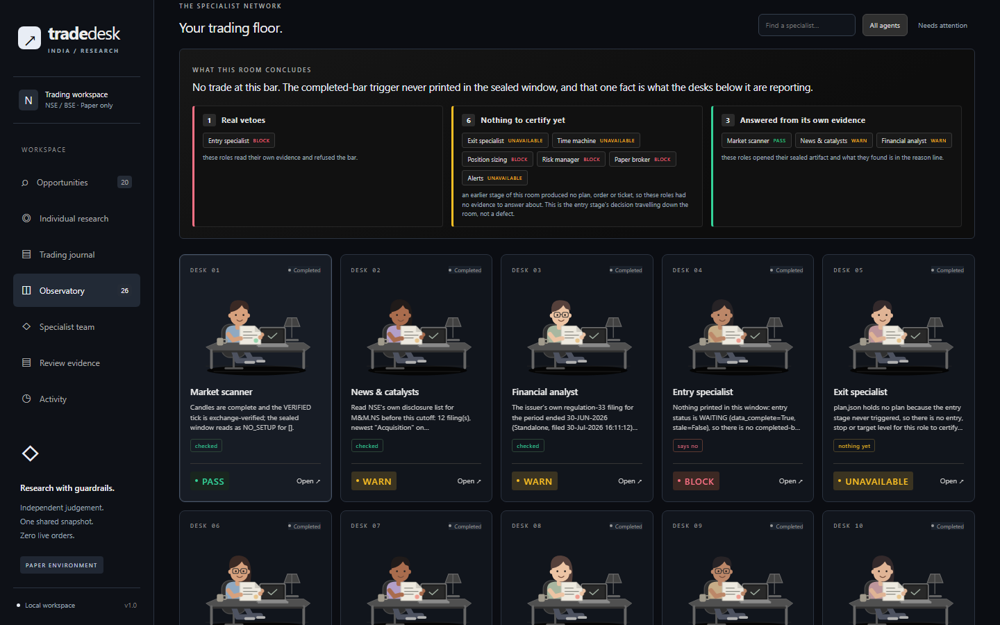

# TradeDesk — an Indian day-trading desk that shows its work

**Ten specialist reviewers. One sealed evidence room. Paper only. No API key.**

[](LICENSE)

[](.github/workflows/ci.yml)

Standard library only · no broker login · no API key · `execution_enabled: false`



---

Most "AI trading desk" projects give you a green button and a vibes-based answer.
This one gives you the opposite: it **refuses out loud, with a reason you can
audit**. Search any NSE stock, and it seals that stock's completed candles,
indicators, risk limits and portfolio into an immutable evidence room, puts ten
independent specialists on it, and ends with one sentence you can actually act on:

```text
CONCLUSION: real veto(s) from entry; 6 role(s) had nothing to certify yet
(alerts, broker, budget, exit, risk, timemachine), because an earlier stage in
this room produced no plan, ticket or order.
```

Four `BLOCK` badges, one real veto — and the desk tells you which is which.

## What it does

| | |
|---|---|
| **Scans for setups** | 15-minute opening-range breakouts *and* five daily setups (20-day closing-high breakout, bull flag, 20-day-average reclaim, oversold RSI under 30, oversold bounce) across your own list or the constituents NSE publishes for any Nifty index |
| **Scores the board** | ADX / +DI / −DI / RSI / ATR / MACD / realized-vol into BUY · HOLD · SELL, with the indicator values behind every verdict |
| **Answers one stock** | `detail RELIANCE` — identity, tick and lot from the exchange's instrument directory, 100 daily bars with the full verdict, today's 5-minute tape and opening range, the live option chain, the issuer's dated exchange filings and the numbers it filed in XBRL |
| **Sizes it in rupees** | Cash, exposure and cost-inclusive risk limits (brokerage, STT, stamp, SEBI, exchange, GST, slippage) against ₹1,00,000 capital and a ₹500 max loss per trade |
| **Risk-checks the exact order** | Tick, timing, costs, cash, daily loss — and it re-derives the numbers itself at finalize time, so a reviewer cannot talk its way into a ticket |
| **Runs the ten specialists** | scanner · news · analyst · entry · exit · time machine · budget · risk · broker · alerts, each reading only its own sealed artifact |
| **Keeps a paper journal** | Append-only ledger, every ticket attempt recorded, dated written report per session and per symbol |
| **Gives you a dashboard** | Local React UI where every next step is a button — including the empty states |

## Who this actually helps

* **The intraday trader who keeps losing to their own conviction.** Before you
  take the trade, it tells you what has to be true for the entry to be valid, what
  your stop costs in rupees after Indian charges, and which stage refuses — in words,
  with the artifact it read.
* **The person learning to trade.** Every verdict carries the indicator values,
  the dated source URL and the rule that fired, so you can argue with it instead of
  trusting it. `desk.py sim RELIANCE` replays the rules you configured over prior
  sessions, so you can see the same decision-making without risking anything.
* **The builder.** The engine is a plain Python package with 12 skill folders and
  hash-sealed evidence, so you can swap the data provider, add a reviewer or reuse
  the cost model without unwinding an AI stack.

## The part that makes it trustworthy

* **Evidence is sealed, then judged.** A room freezes the candles, indicators,
  limits and portfolio into `context.json` with a hash per artifact. Every review
  is bound to those hashes, so a verdict cannot be quietly re-used from another
  order or another day.
* **A badge is not a reason.** Every specialist records *why*: `veto` (read the
  evidence and refused), `nothing-to-check` (no plan or order exists yet),
  `evidence-gap` (looked for dated exchange proof, found none), `confirmed`. One
  entry-stage veto empties six desks downstream — the desk says so instead of
  showing you seven failures.
* **It cites or it shrugs.** `news` and `analyst` open the exchange itself — NSE's
  corporate-announcement archive and the issuer's SEBI regulation-33 XBRL instance —
  and their verdict is only accepted if every source is an https URL on
  `nseindia.com`/`bseindia.com`, published at or before the room's cutoff. No
  citation, no pass. A fabricated number would corrupt the room, so the honest
  answer is `UNAVAILABLE`.
* **Consent stays yours.** The desk prints a draft paper ticket and waits. It is
  booked only after *your own* reply that starts with `yes` and names the
  instrument, and the ticket must be under a minute old. Nothing in this repo can
  submit an order — `execution_enabled` is `false` in every code path.
* **Limits are tighten-only from the UI.** You can lower the ₹500 risk budget from
  the dashboard; you cannot widen it.

## Quick start

```sh
git clone https://github.com/85599/nse-paper-trading-desk.git
cd nse-paper-trading-desk
python scripts/desk.py doctor              # python, config, tick registry, feed, ledger
python scripts/registry.py                 # optional: rebuild the dated tick registry
python scripts/desk.py premarket           # daily setups across config/universe-liquid.txt
python scripts/desk.py detail RELIANCE     # one live read of any NSE name
python scripts/desk.py team-review "M&M"   # seal it and run the ten specialists
python scripts/desk.py dashboard           # local React UI on http://127.0.0.1:8788
```

No `pip install`, no virtualenv, no API key, no account. The dashboard build is the
only step that needs Node (`npm install && npm run build` inside
`vendor/day-trader-skill-codex/dashboard`).

## A real room, start to finish

```text
== idfcfirstb-20261109-153951 ==
IDFCFIRSTB.NS | as of 2026-11-09T15:39:53 | BLOCKED
reviews: 10/10 recorded, 10 distinct agent ids
  scanner     PASS        Candles are complete and the VERIFIED tick is exchange-verified…
  news        WARN        Read NSE's own disclosure list for IDFCFIRSTB.NS before this cutoff:
                          12 filing(s), newest "ESOP/ESOS/ESPS" on nsearchives.nseindia.com
  analyst     WARN        The issuer's own regulation-33 filing for the period ended 30-SEP-2026
                          (Standalone, filed 24-Oct-2026 18:39:32) reports Total income Rs 14,217.78 cr…
  entry       BLOCK       Nothing printed in this window: entry status is EXPIRED (data_complete=True,
                          stale=True), so there is no completed-bar event to act on.
  budget      BLOCK       The budget stage has nothing to size because the entry stage never
                          triggered (no_eligible_entry). No cash, order or daily-loss limit was
                          reached — ₹90,000.00 of cash and ₹500.00 of risk room were still free.
  risk        BLOCK       The risk stage has no order to veto: the only reason recorded is
                          no_eligible_entry, which is the entry stage never triggering, not a limit breach.
CONCLUSION: real veto(s) from entry; 6 role(s) had nothing to certify yet…
paper ticket: none -- status is BLOCKED
live orders submitted: 0 | execution_enabled: False
```

That is a *working* room. There was no valid breakout, the desk said so in one
sentence, and it did not invent a trade to look useful.

## Requirements

| | |
|---|---|
| Python | 3.10+ — CI checks 3.10, 3.12 and 3.14 (developed on 3.14, standard library only) |
| OS | Built and tested on Windows 11. `india/job.py` needs `fcntl`, so scheduling is foreground polling instead of a background daemon |
| Node | 20.19+ / 22.12+ — only to build the dashboard |
| Data | NSE's public charting and option-chain endpoints, plus the exchange's announcement and XBRL archives. No key. Optional: `UPSTOX_ANALYTICS_TOKEN` in your own environment |

## What it is not

* Not live trading. No broker connection, no orders, no futures, no margin, no
  shorting, no fractional shares. Option **chains** are read for context (premium,
  IV, OI, PCR, lot, tick) but no option leg is sized or risk-checked — the engine's
  model is whole-share cash-segment equity.
* Not investment advice, and not a signal service. It is a simulated account whose
  job is to make the reasoning inspectable.
* Not a guaranteed data feed. NSE labels its public website endpoints experimental;
  they rate-limit and change. The desk prints the refusal instead of interpolating.
* Not a redistributor of market data. `workspace/`, the ledger, cached filings, the
  downloaded instrument master and generated reports are all gitignored — the
  exchange's terms do not allow republishing them.

## Documentation

* **[RUNBOOK.md](RUNBOOK.md)** — the actual 08:45-to-15:05 routine, one command per step.
* **[DETAILS.md](DETAILS.md)** — every captured run, defect found and fixed, and the
  reasoning behind the guardrails.
* **[vendor/day-trader-skill-codex/README.md](vendor/day-trader-skill-codex/README.md)** — the engine's own docs.

## Attribution and license

This desk is a wrapper. The engine inside `vendor/day-trader-skill-codex` is
[`jackson-kanchanapally/day-trader-skill-codex`](https://github.com/jackson-kanchanapally/day-trader-skill-codex),
MIT © Jake Schincariol, which itself adapts
[`Jakeschincariol/day-trader-skill`](https://github.com/Jakeschincariol/day-trader-skill) —
their `LICENSE` and `NOTICE.md` are kept in that folder. What this repo adds is the
Windows-safe orchestrator (`scripts/desk.py` and its modules), the sealed-room
reviewers with reason codes and conclusions, the keyless NSE adapters for
announcements, XBRL filings, option chains and index constituents, the paper journal,
and the dashboard work. Upstream's test fixtures (which contain captured provider
payloads) are deliberately not redistributed here.

MIT — © [85599](https://github.com/85599). See [LICENSE](LICENSE).

If this saved you from taking a trade you should not have taken, a star helps more
than it knows. Issues and "why did it refuse *this*" questions are genuinely welcome —
that is the part of the design still being hardened.
